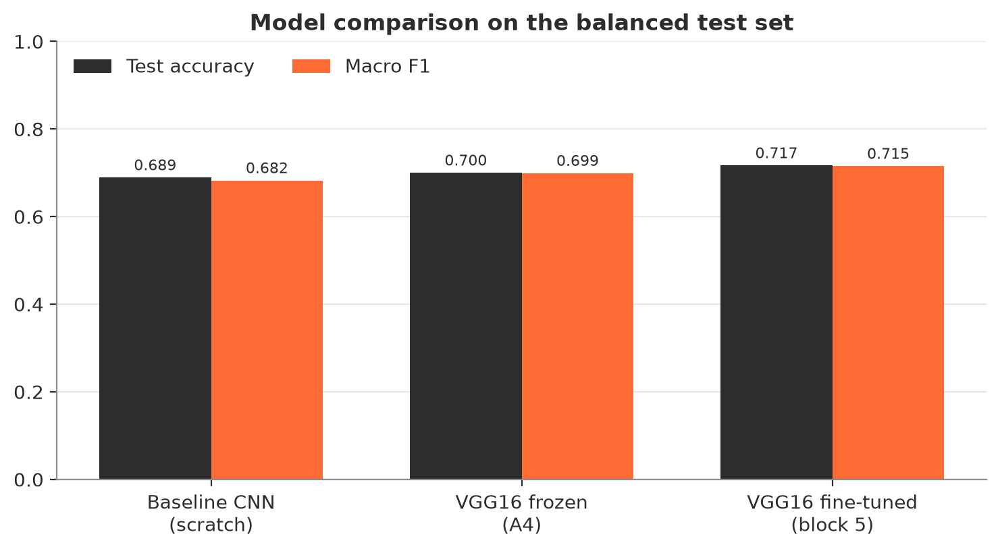
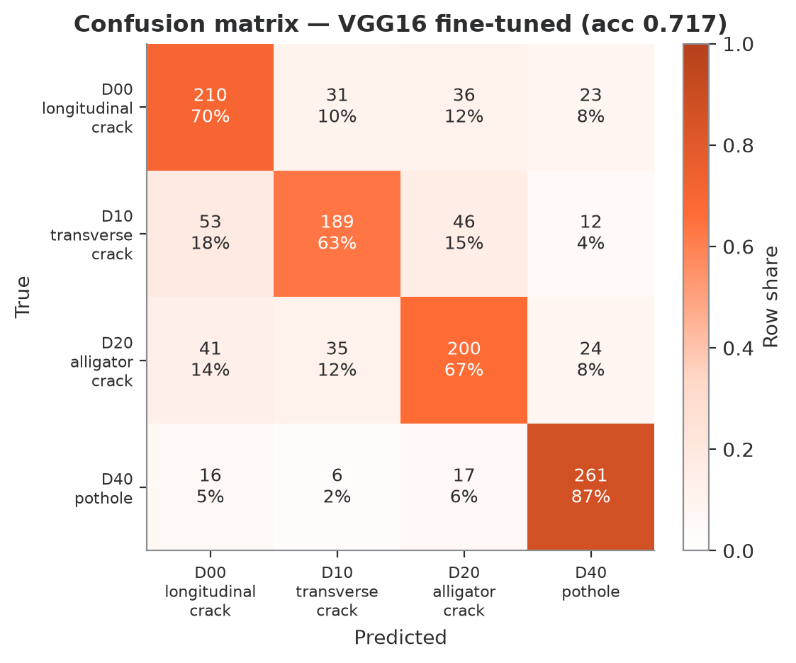
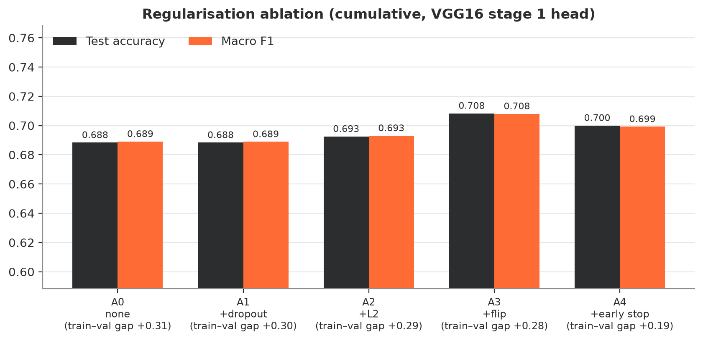
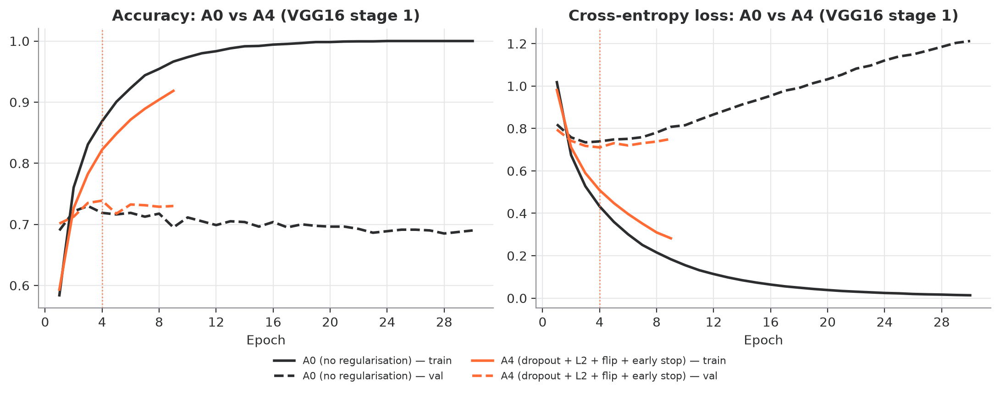
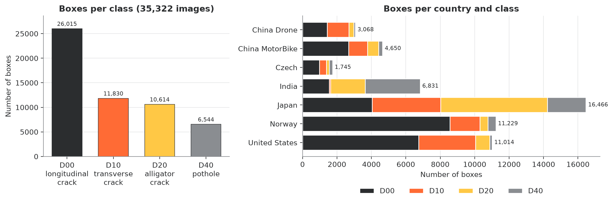
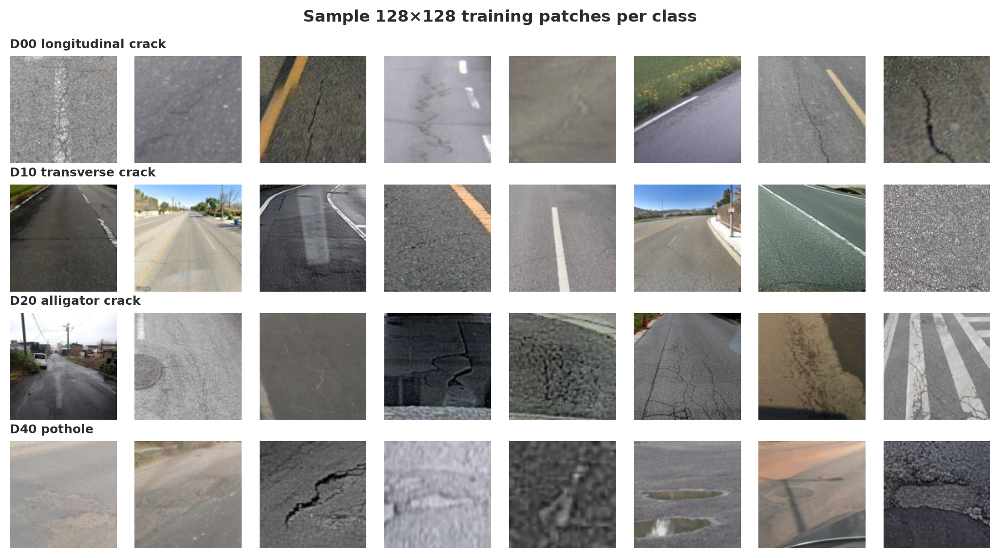
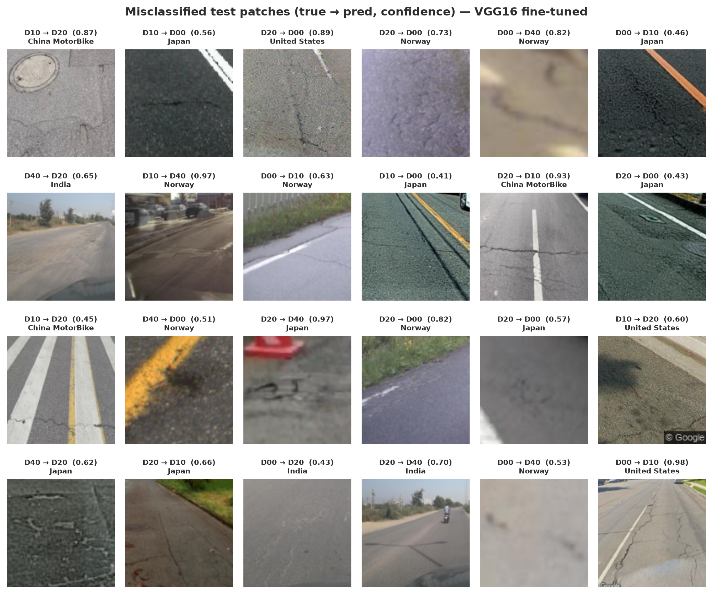
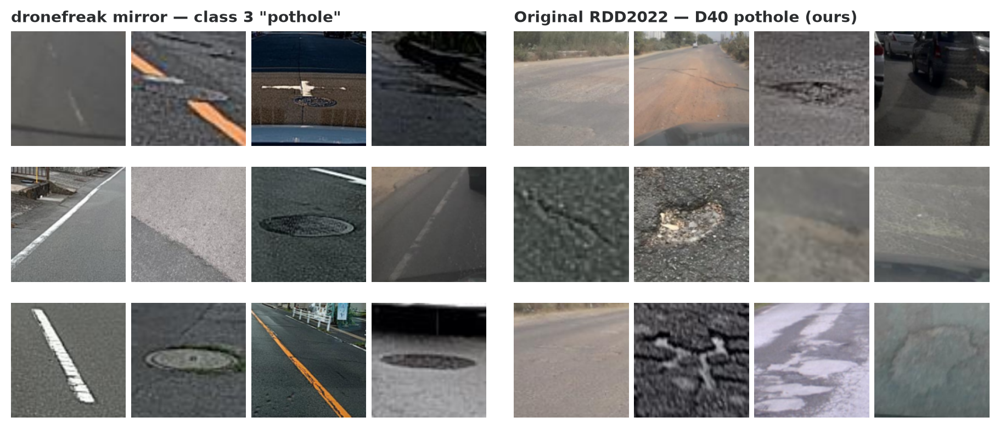

# DamageNet-VGG16

**Transfer learning with VGG16 to classify road-damage patches from RDD2022 into 4 classes.**
University case study for *21CSC406J Neural Networks & Deep Learning*, SRM Institute of Science and Technology.

**Team:** S Harshni · Khushal Narsaria · Aditya Sharma · Harsh Pandey

| Code | Class | Label |
|---|---|---|
| D00 | longitudinal crack | 0 |
| D10 | transverse crack | 1 |
| D20 | alligator crack | 2 |
| D40 | pothole | 3 |

<!-- RESULTS:START -->
## Results

Balanced test set of 1,200 patches (300 per class), image-level split, seed 42.

| Model | Test accuracy | Macro F1 | Val accuracy |
|---|---|---|---|
| Baseline CNN (scratch, 64×64) | **0.689** | 0.683 | 0.671 |
| VGG16 frozen (feature extraction, A4) | **0.700** | 0.699 | 0.739 |
| VGG16 fine-tuned (block 5) | **0.717** | 0.715 | 0.746 |

- Pothole (D40) is the easiest class (F1 0.84). **71% of the fine-tuned model's errors are
  confusions between crack types** (D00/D10/D20).
- Each added regulariser helps a little: A0 0.688 → A3 0.708 test accuracy. Early stopping (A4)
  closes the train/val gap (train 1.00 → 0.92) at about the same accuracy.
- VGG16 test accuracy is about 4 points below its validation accuracy and below our expected
  ballpark (74%/76%). Validation matches the ballpark, so this looks like split variance, not a
  bug. The assembled checkpoint reproduces the cached-feature result exactly on raw test patches.
- Full details: [`results/summary.md`](results/summary.md). Error analysis by country and box size:
  [`results/analysis.json`](results/analysis.json).

| | |
|---|---|
|  |  |
|  |  |




<!-- RESULTS:END -->

## Overview

1. **Data.** We download the *original* Pascal-VOC annotations of RDD2022 (35,322 images from 7
   country subsets) and keep only D00/D10/D20/D40 boxes.
2. **Patches.** A seeded 70/15/15 split at the **image level** (no image is in two splits). Each
   box becomes a square crop centred on the box (side = 1.15 × max(w, h), kept inside the
   image), resized to 128×128. Sampling is class-balanced: 900/200/300 patches per class for
   train/val/test, at most 2 per class per image.
3. **Models.**
   - *Baseline CNN* from scratch on 64×64 patches: 4 × [Conv3×3-BN-ReLU-MaxPool] (32, 64, 128, 128) → FC128 → Dropout 0.5 → FC4.
   - *VGG16* (torchvision `IMAGENET1K_V1`, ImageNet normalisation, 128×128 input) with a new head:
     Flatten(8192) → Dense256 + ReLU → Dropout 0.5 → Dense4.
     - **Stage 1, feature extraction:** blocks 1–5 frozen, head trained with Adam (lr 1e-4).
       Cumulative regularisation ablation: **A0** none → **A1** + dropout → **A2** + L2 1e-3 →
       **A3** + horizontal-flip copies → **A4** + early stopping (final stage-1 model).
     - **Stage 2, fine-tuning:** start from A4 and unfreeze block 5 (lr 1e-5; head lr 1e-4,
       weight decay 1e-3, at most 8 epochs, patience 3).
   - *Speed trick:* blocks 1–4 (`features[:24]`) never change, so their outputs are computed
     once and cached (train, train flipped, val, test). Stage 1 also caches block 5.
4. **Augmentation.** Only horizontal flips. **Vertical flips and 90° rotations are never used**
   because they would turn a longitudinal crack (D00) into a transverse crack (D10).
5. **Evaluation.** Test accuracy, macro P/R/F1, confusion matrix, classification report,
   accuracy by country and by box size, top confusions, and the share of errors that are
   crack-type confusions.

## ⚠️ Label-mirror warning

Do **not** use the `dronefreak/RDD2022` mirror for this task. Its class 3 "pothole" merges the
original codes D43 (crosswalk blur), D44 (white-line blur) and D50 (manhole cover), so most of
its "potholes" are manholes, lane markings and crosswalks. We use the original Pascal-VOC files
from [`FelipeS09/urmind-rdd2022`](https://huggingface.co/datasets/FelipeS09/urmind-rdd2022)
instead. `scripts/label_audit.py` puts mirror "potholes" next to clean D40 patches
(below).



We also ignore that repository's own split lists' *split*: they split by country, so we only
use them to get file names and make our own image-level random split.

## Setup

Requires Python 3.10–3.12 and git. A GPU is optional (CUDA or Apple MPS is picked
automatically; otherwise it runs on CPU).

```bash
git clone https://github.com/S-Harshni/damagenet-vgg16.git
cd damagenet-vgg16
python3 -m venv .venv
source .venv/bin/activate          # Windows: .venv\Scripts\activate
pip install -r requirements.txt
```

## How to run

Full pipeline (download → patches → train all models → evaluate → figures → `results/summary.md`):

```bash
python -m src.run_all              # or: scripts/run_all.sh
```

Quick smoke test on a tiny subset (20 patches per class, 2 epochs, outputs go to `debug/`):

```bash
python -m src.run_all --debug
```

Individual steps: `python -m src.data`, `python -m src.patches`, `python -m src.train`
(`--only baseline|cache|stage1|stage2`), `python -m src.evaluate`, `python -m src.figures`.
All hyperparameters are in [`configs/default.yaml`](configs/default.yaml). Seeds are fixed
(42) for `random`, NumPy and PyTorch; logs go to the console and `results/logs/`.

**Downloads.** The ~35k annotation XMLs are fetched with one sparse git clone of the `xmls/`
folders (about 10 s). Images are fetched one by one with `huggingface_hub` (parallel and
resumable), and only the ~4.9k images that the sampled patches need. Anonymous Hugging Face
requests are rate-limited, so this step can take 30–60 min; it is much faster with a free
token: `export HF_TOKEN=hf_...`. Set `dataset.xml_download: hf` to fetch the XMLs with
`huggingface_hub` as well.

Tests:

```bash
pytest -q
```

### Pre-trained model and demo app

The fine-tuned model is attached to the
[v1.0 release](https://github.com/S-Harshni/damagenet-vgg16/releases/tag/v1.0) (not committed to git):

```bash
mkdir -p checkpoints
curl -L -o checkpoints/vgg16_ft.pt https://github.com/S-Harshni/damagenet-vgg16/releases/download/v1.0/vgg16_ft.pt
# or: gh release download v1.0 -R S-Harshni/damagenet-vgg16 -D checkpoints
streamlit run app/streamlit_app.py
```

Upload a road photo and drag a box around the damage, or upload a ready-cut patch. The app
shows the predicted class and the probabilities. `notebooks/demo.ipynb` walks through the
saved results and figures.

## Repository layout

```
configs/default.yaml     every hyperparameter
src/data.py              download + parse Pascal-VOC XMLs -> data/ann.json, data/stats.json
src/patches.py           image-level split, square crops, balanced sampling -> data/patches/*.npz
src/models.py            baseline CNN, VGG16 head, full VGG16 classifier
src/features.py          cached VGG16 block-4 / block-5 features
src/train.py             baseline, stage 1 + ablation, stage 2 fine-tuning
src/evaluate.py          metrics, error analysis, results/summary.md
src/figures.py           all figures (200 dpi) -> figures/
src/run_all.py           one-command pipeline
scripts/run_all.sh       shell wrapper     scripts/label_audit.py   mirror label audit
app/streamlit_app.py     demo app          notebooks/demo.ipynb     results walkthrough
tests/                   pytest: XML parsing, square cropping, split leakage
results/                 *.json per run, analysis.json, summary.md
figures/                 PNG figures
```

## Expected results

Rough targets on the balanced 1,200-patch test set: scratch CNN ≈ 67% accuracy, VGG16 frozen
≈ 74%, VGG16 fine-tuned ≈ 76%. Pothole is the easiest class (F1 ≈ 0.88), and about 75% of
errors are confusions between crack types. Our run gives 68.9% / 70.0% / 71.7% (validation 67.1% / 73.9% /
74.6%), pothole F1 0.84 and a 71% crack-confusion share. The ordering and error structure match;
see the Results section above.

**Runtime.** The training and evaluation steps take about 6 min on an Apple M-series GPU (MPS)
and roughly 20–40 min on a laptop CPU. A first run adds the image downloads (about 45 min
anonymous, much faster with `HF_TOKEN`).

## Dataset credit

RDD2022, from D. Arya, H. Maeda, S. K. Ghosh, D. Toshniwal, Y. Sekimoto et al., *"RDD2022: A
multi-national image dataset for automatic road damage detection"*, Crowdsensing-based Road
Damage Detection Challenge (CRDDC 2022). Licence **CC BY-SA 4.0**.
DOI: [10.6084/m9.figshare.21431547](https://doi.org/10.6084/m9.figshare.21431547).
Annotation files from the Hugging Face copy `FelipeS09/urmind-rdd2022`.
