# DamageNet-VGG16

**Transfer learning with VGG16 to classify road-damage patches from RDD2022 into 4 classes.**
University case study for *21CSC406J Neural Networks & Deep Learning*, SRM Institute of Science and Technology.

**Team:** S Harshni · Khushal Narsaria · Aditya Sharma · Harsh Pandey

| Code | Class | Label |
|---|---|---|
| D00 | longitudinal crack | 0 |
| D10 | transverse crack | 1 |
| D20 | alligator crack | 2 |
| D40 | pothole | 3 |

<!-- RESULTS:START -->
## Results

Balanced test set of 1,200 patches (300 per class), image-level split, seed 42.

| Model | Test accuracy | Macro F1 | Val accuracy |
|---|---|---|---|
| Baseline CNN (scratch, 64×64) | **0.689** | 0.683 | 0.671 |
| VGG16 frozen (feature extraction, A4) | **0.700** | 0.699 | 0.739 |
| VGG16 fine-tuned (block 5) | **0.717** | 0.715 | 0.746 |

- Pothole (D40) is the easiest class (F1 0.84). **71% of the fine-tuned model's errors are
  confusions between crack types** (D00/D10/D20).
- Each added regulariser helps a little: A0 0.688 → A3 0.708 test accuracy. Early stopping (A4)
  closes the train/val gap (train 1.00 → 0.92) at about the same accuracy.
- VGG16 test accuracy is about 4 points below its validation accuracy and below our expected
  ballpark (74%/76%). Validation matches the ballpark, so this looks like split variance, not a
  bug. The assembled checkpoint reproduces the cached-feature result exactly on raw test patches.
- Full details: [`results/summary.md`](results/summary.md). Error analysis by country and box size:
  [`results/analysis.json`](results/analysis.json).

| | |
|---|---|
| 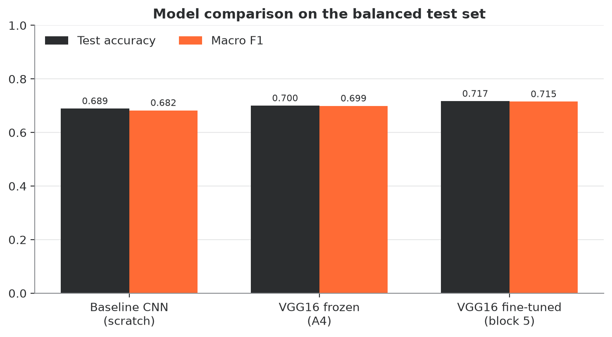 | 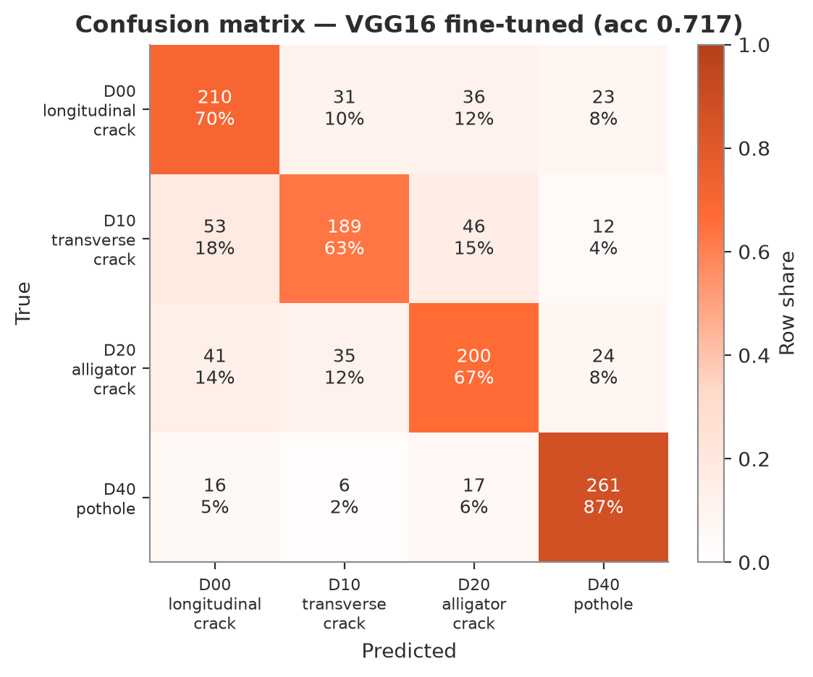 |
| 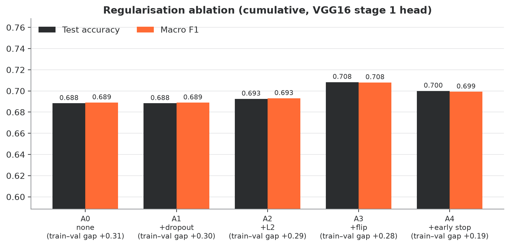 | 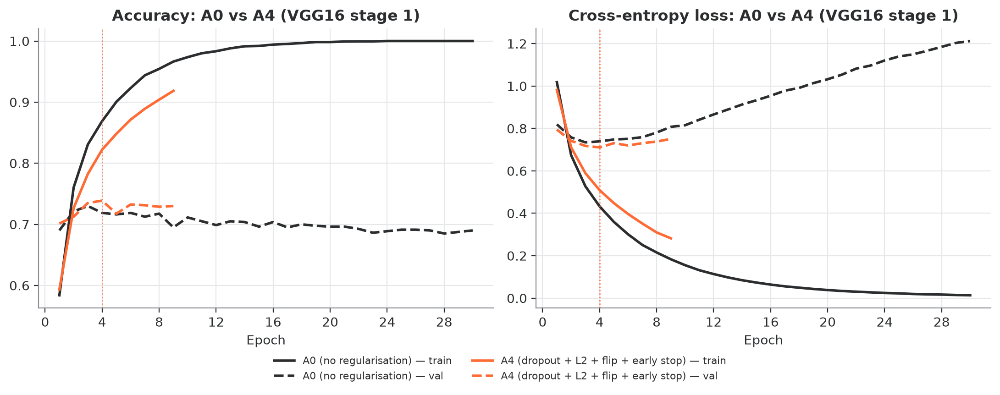 |

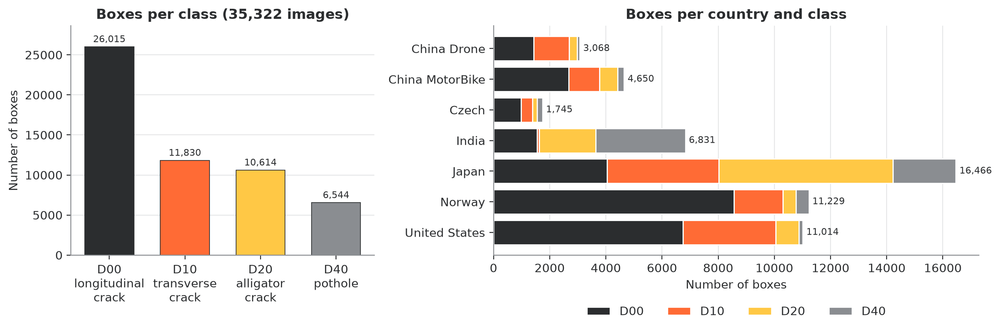
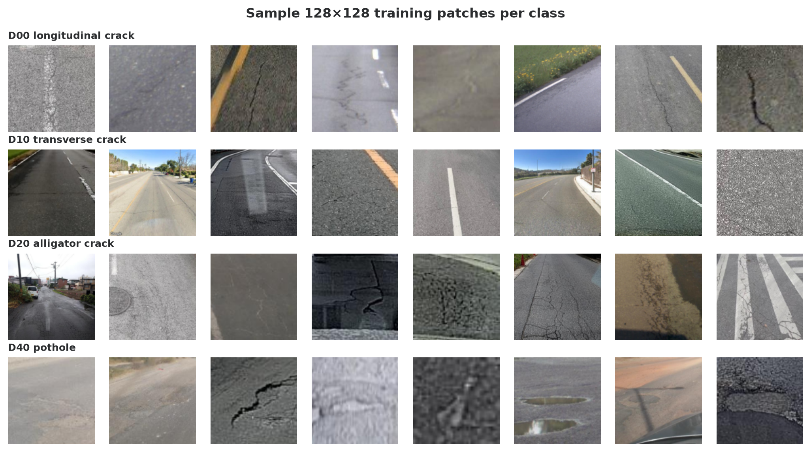
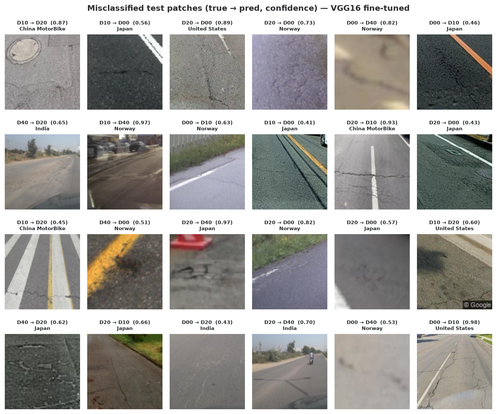
<!-- RESULTS:END -->

## Overview

1. **Data.** We download the *original* Pascal-VOC annotations of RDD2022 (35,322 images from 7
   country subsets) and keep only D00/D10/D20/D40 boxes.
2. **Patches.** A seeded 70/15/15 split at the **image level** (no image is in two splits). Each
   box becomes a square crop centred on the box (side = 1.15 × max(w, h), kept inside the
   image), resized to 128×128. Sampling is class-balanced: 900/200/300 patches per class for
   train/val/test, at most 2 per class per image.
3. **Models.**
   - *Baseline CNN* from scratch on 64×64 patches: 4 × [Conv3×3-BN-ReLU-MaxPool] (32, 64, 128, 128) → FC128 → Dropout 0.5 → FC4.
   - *VGG16* (torchvision `IMAGENET1K_V1`, ImageNet normalisation, 128×128 input) with a new head:
     Flatten(8192) → Dense256 + ReLU → Dropout 0.5 → Dense4.
     - **Stage 1, feature extraction:** blocks 1–5 frozen, head trained with Adam (lr 1e-4).
       Cumulative regularisation ablation: **A0** none → **A1** + dropout → **A2** + L2 1e-3 →
       **A3** + horizontal-flip copies → **A4** + early stopping (final stage-1 model).
     - **Stage 2, fine-tuning:** start from A4 and unfreeze block 5 (lr 1e-5; head lr 1e-4,
       weight decay 1e-3, at most 8 epochs, patience 3).
   - *Speed trick:* blocks 1–4 (`features[:24]`) never change, so their outputs are computed
     once and cached (train, train flipped, val, test). Stage 1 also caches block 5.
4. **Augmentation.** Only horizontal flips. **Vertical flips and 90° rotations are never used**
   because they would turn a longitudinal crack (D00) into a transverse crack (D10).
5. **Evaluation.** Test accuracy, macro P/R/F1, confusion matrix, classification report,
   accuracy by country and by box size, top confusions, and the share of errors that are
   crack-type confusions.

## ⚠️ Label-mirror warning

Do **not** use the `dronefreak/RDD2022` mirror for this task. Its class 3 "pothole" merges the
original codes D43 (crosswalk blur), D44 (white-line blur) and D50 (manhole cover), so most of
its "potholes" are manholes, lane markings and crosswalks. We use the original Pascal-VOC files
from [`FelipeS09/urmind-rdd2022`](https://huggingface.co/datasets/FelipeS09/urmind-rdd2022)
instead. `scripts/label_audit.py` puts mirror "potholes" next to clean D40 patches
(below).

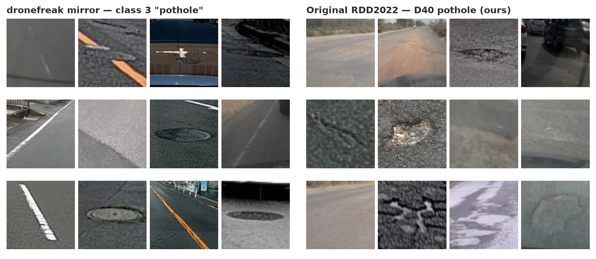

We also ignore that repository's own split lists' *split*: they split by country, so we only
use them to get file names and make our own image-level random split.

## Setup

Requires Python 3.10–3.12 and git. A GPU is optional (CUDA or Apple MPS is picked
automatically; otherwise it runs on CPU).

```bash
git clone https://github.com/S-Harshni/damagenet-vgg16.git
cd damagenet-vgg16
python3 -m venv .venv
source .venv/bin/activate          # Windows: .venv\Scripts\activate
pip install -r requirements.txt
```

## How to run

Full pipeline (download → patches → train all models → evaluate → figures → `results/summary.md`):

```bash
python -m src.run_all              # or: scripts/run_all.sh
```

Quick smoke test on a tiny subset (20 patches per class, 2 epochs, outputs go to `debug/`):

```bash
python -m src.run_all --debug
```

Individual steps: `python -m src.data`, `python -m src.patches`, `python -m src.train`
(`--only baseline|cache|stage1|stage2`), `python -m src.evaluate`, `python -m src.figures`.
All hyperparameters are in [`configs/default.yaml`](configs/default.yaml). Seeds are fixed
(42) for `random`, NumPy and PyTorch; logs go to the console and `results/logs/`.

**Downloads.** The ~35k annotation XMLs are fetched with one sparse git clone of the `xmls/`
folders (about 10 s). Images are fetched one by one with `huggingface_hub` (parallel and
resumable), and only the ~4.9k images that the sampled patches need. Anonymous Hugging Face
requests are rate-limited, so this step can take 30–60 min; it is much faster with a free
token: `export HF_TOKEN=hf_...`. Set `dataset.xml_download: hf` to fetch the XMLs with
`huggingface_hub` as well.

Tests:

```bash
pytest -q
```

### Pre-trained model and demo app

The fine-tuned VGG16 is attached to the
[v1.0 release](https://github.com/S-Harshni/damagenet-vgg16/releases/tag/v1.0) and the damage
detector to the [v1.1 release](https://github.com/S-Harshni/damagenet-vgg16/releases/tag/v1.1)
(not committed to git):

```bash
mkdir -p checkpoints
curl -L -o checkpoints/vgg16_ft.pt https://github.com/S-Harshni/damagenet-vgg16/releases/download/v1.0/vgg16_ft.pt
curl -L -o checkpoints/detector.pt https://github.com/S-Harshni/damagenet-vgg16/releases/download/v1.1/detector.pt
streamlit run app/streamlit_app.py
```

Input modes:

- **Video** (mp4/mov/avi/mkv/webm, first 2 minutes, or *Try a sample drive*): click *Find
  damage*. The app returns the video with a steady box, class and confidence drawn on every
  frame (downloadable as mp4), a count per damage type, a timeline of when each damage is on
  screen, and a gallery of each damage's best view (click its time to jump there) plus a table
  with a VGG16 re-check. Counts are approximate: a damage the detector loses for a while can get
  a second ID. Sidebar settings: accuracy preset (*Fast* / *Balanced* / *Best*, default Best),
  minimum confidence (default 0.50 for Best, 0.40 otherwise), damage types, how often the detector
  runs (boxes are drawn on every frame either way) and *Steady boxes* (on; off shows the raw
  detector output). About 3 min for a 1-minute 720p clip with *Best* on Apple MPS.
  The theme is in `.streamlit/config.toml` (dark, Inter / Space Grotesk fonts).
- **Photo**: the same automatic boxes on a photo, plus an option to drag your own box
  and classify it with VGG16.
- **Patch**: classify an already-cropped patch with VGG16.

## Automatic damage detection (video mode)

VGG16 is a patch classifier: it needs a box and has no "no damage" class, so it cannot find
damage by itself. For the video mode we add a detector, `src/detect.py`: **Faster R-CNN with a
MobileNetV3-Large FPN backbone** (torchvision, COCO-pretrained) fine-tuned on the RDD2022 boxes
(D00/D10/D20/D40) of the **same seeded image-level split**, so the test images are unseen by both
models. Horizontal flips only, as for the classifier.

```bash
python -m src.detect                               # download images, train (~2.3 h on Apple MPS), evaluate on test
python -m src.detect --only eval --split val --tta # evaluate with flip test-time augmentation
python -m src.detect --only eval --split val --tta --scales 576 704  # + a second input size ("Best")
python -m src.figures --detector                   # detector figures
```

**Results on the held-out test images** (1,254 images, VOC AP at IoU 0.5; F1 is the RDD
challenge metric):

| Detector | Train images | mAP@0.5 | D00 | D10 | D20 | D40 pothole | F1 @ 0.40 |
|---|---|---|---|---|---|---|---|
| Baseline: 512 px, 6 epochs | 4,815 | 0.303 | 0.233 | 0.221 | 0.503 | 0.253 | 0.36 |
| Improved: + 10k images, multi-scale 448–576 px, 5 epochs | 14,815 | 0.345 | 0.288 | 0.300 | 0.541 | 0.251 | 0.40 |
| Improved + horizontal-flip TTA (app "Balanced") | 14,815 | 0.355 | 0.302 | 0.302 | 0.556 | 0.261 | 0.40 |
| **Improved + flip TTA at 576 + 704 px (app "Best", default)** | 14,815 | **0.384** | **0.325** | **0.356** | **0.564** | **0.289** | **0.42** (@ 0.50) |

How the final model was chosen (no tuning on the test set):

- Training images: every image used by the patch dataset, every image with a pothole, plus
  (improved run) 10,000 further random *training* images. Validation and test images are
  identical for both runs.
- The checkpoint is the epoch with the best **validation** mAP (epoch 4 of 5). Flip TTA was
  kept because it raised validation mAP from 0.366 to 0.377 and validation pothole AP from 0.250
  to 0.265. The app's default confidence threshold (0.40) is the one with the best validation F1.
- Multi-scale TTA (same weights, no retraining): running the detector at 576 *and* 704 px and
  merging raised validation mAP from 0.377 to 0.400 and best validation F1 from 0.422 to 0.439
  (at score 0.50, so *Best* defaults to 0.50). Adding 832 px as well gave only 0.404 for 50% more
  compute, so it was dropped. Merging overlapping boxes of different classes (used for display)
  costs < 0.1 F1 point on validation.
- Tried and dropped: fine-tuning the whole MobileNetV3 backbone. It was about 2× slower per step
  (5 epochs would have taken ~6 h) and did not fit the time budget.
- More data helped every crack class (+6 to +8 AP points); pothole AP stayed about the same
  (0.25–0.26). RDD2022 pothole boxes are inconsistent: some outline one hole, others a whole
  stretch of broken road, so there is a ceiling on how well any model can match them.

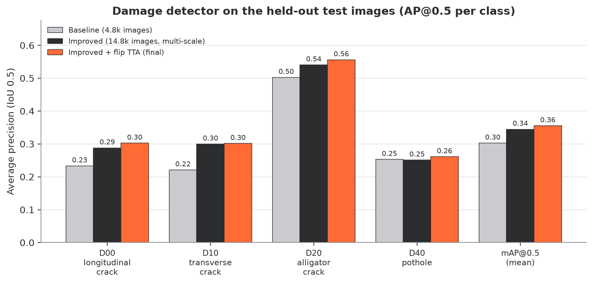
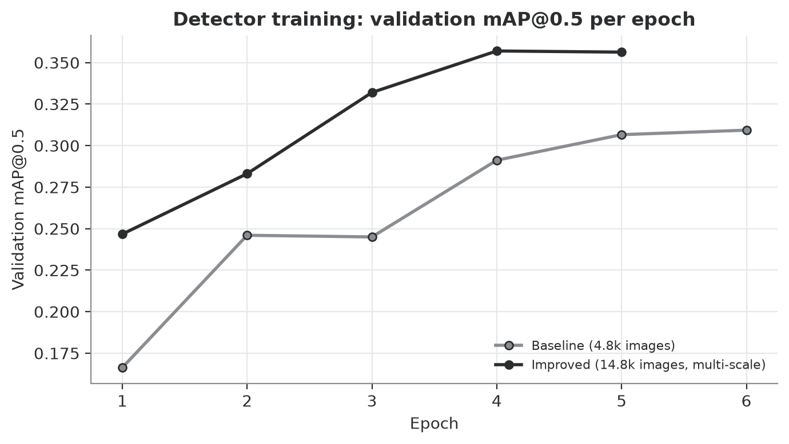
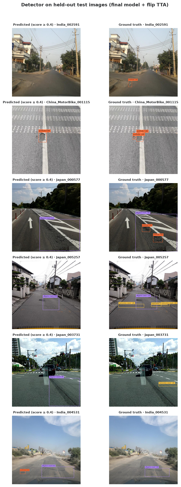

### Steady boxes on video

Raw per-frame detections flicker: a damage's score hovers around the threshold so its box blinks,
its class can switch between frames, and the box wobbles. `src/video.py` therefore:

1. merges overlapping boxes of different classes (the detector's NMS is per class);
2. links detections into tracks using each track's *predicted* box (linear fit of centre and
   log size over its last 4 detections), so damage growing as the car approaches keeps one ID;
   only detections above the threshold start a track, weaker ones (down to half) may extend one;
3. keeps a track only if it was detected on >= 4 detector runs and its confidence (mean of its 3
   best scores) reaches the threshold;
4. since the whole video is processed before it is shown, smooths each track with past *and*
   future detections (local linear Gaussian-kernel regression over time), interpolates frames
   between detector runs, and gives each damage one class and one confidence for its life.

Measured with `python scripts/video_stability.py`: RDD2022 has no videos, so it builds simulated
drives (16 held-out photos, each zoomed 1x→2x towards the horizon with camera shake, 25 fps) with
exact per-frame ground truth. Settings were chosen on a drive made from validation photos; this is
the drive made from **test** photos (`results/video_stability.json`, detector every 2nd frame):

| Per minute of video | Raw detections (before) | Steady boxes |
|---|---|---|
| Blinks (box disappears and comes back) | 50.0 | **5.2** (−90%) |
| Track-ID switches on the same damage | 46.9 | **13.5** (−71%) |
| Box wobble, % of box size per frame | 3.1 | **1.9** (−38%) |
| Class switches on the same damage | 5.2 | 4.2 |
| Damages counted (true: 37) | 103 | **72** |
| False boxes per frame | 1.21 | 1.19 |
| Per-frame F1 (IoU 0.5, right class) | 0.344 | 0.321 |

Trade-off: per-frame F1 on the test drive drops 2 points (on the dev drive it rose from 0.396 to
0.409) because a damage now appears only once it is confirmed and short true detections are
dropped with the blips. *Steady boxes* can be switched off in the app. Tried and dropped (dev drive): joining a
track that ends onto one that starts shortly after nearby ("stitching") cut the count only from 79
to 73 and lowered F1 from 0.409 to 0.371; looser matching (IoU 0.15) or a longer gap (1 s) did not
beat the defaults either.

The detector-and-tracker output is drawn on every frame and re-encoded as an H.264 mp4 in memory. The fine-tuned VGG16 re-classifies the best view of each tracked damage
("VGG16 check" column) as a second opinion. `notebooks/demo.ipynb` walks through the
saved results and figures.

## Repository layout

```
configs/default.yaml     every hyperparameter
src/data.py              download + parse Pascal-VOC XMLs -> data/ann.json, data/stats.json
src/patches.py           image-level split, square crops, balanced sampling -> data/patches/*.npz
src/models.py            baseline CNN, VGG16 head, full VGG16 classifier
src/features.py          cached VGG16 block-4 / block-5 features
src/detect.py            Faster R-CNN damage detector (train + VOC AP evaluation)
src/video.py             video tracking + smoothing, boxes drawn on video
scripts/video_stability.py  simulated-drive benchmark: raw vs steady boxes
src/train.py             baseline, stage 1 + ablation, stage 2 fine-tuning
src/evaluate.py          metrics, error analysis, results/summary.md
src/figures.py           all figures (200 dpi) -> figures/
src/run_all.py           one-command pipeline
scripts/run_all.sh       shell wrapper     scripts/label_audit.py   mirror label audit
app/streamlit_app.py     demo app          notebooks/demo.ipynb     results walkthrough
tests/                   pytest: XML parsing, cropping, split leakage, detector + video
results/                 *.json per run, analysis.json, summary.md
figures/                 PNG figures
```

## Expected results

Rough targets on the balanced 1,200-patch test set: scratch CNN ≈ 67% accuracy, VGG16 frozen
≈ 74%, VGG16 fine-tuned ≈ 76%. Pothole is the easiest class (F1 ≈ 0.88), and about 75% of
errors are confusions between crack types. Our run gives 68.9% / 70.0% / 71.7% (validation 67.1% / 73.9% /
74.6%), pothole F1 0.84 and a 71% crack-confusion share. The ordering and error structure match;
see the Results section above.

**Runtime (measured).** Patches + training + evaluation take 5.4 min on an Apple M-series GPU
(MPS) and 16.5 min CPU-only on the same laptop (10-core Apple M-series). A first run adds the
image downloads (about 45 min anonymous, much faster with `HF_TOKEN`).

**Reproducibility.** Seeds are fixed, and repeated runs on the same device give identical numbers.
Different devices (CPU / MPS / CUDA) use different floating-point kernels, so results can move by
a point or two. Our CPU-only run gave baseline 66.3%, VGG16 frozen 70.7%, fine-tuned 71.9%, against
68.9% / 70.0% / 71.7% for the published MPS run.

## Dataset credit

RDD2022, from D. Arya, H. Maeda, S. K. Ghosh, D. Toshniwal, Y. Sekimoto et al., *"RDD2022: A
multi-national image dataset for automatic road damage detection"*, Crowdsensing-based Road
Damage Detection Challenge (CRDDC 2022). Licence **CC BY-SA 4.0**.
DOI: [10.6084/m9.figshare.21431547](https://doi.org/10.6084/m9.figshare.21431547).
Annotation files from the Hugging Face copy `FelipeS09/urmind-rdd2022`.
